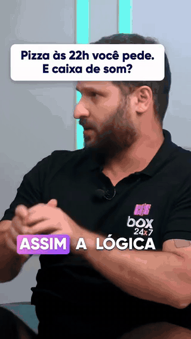
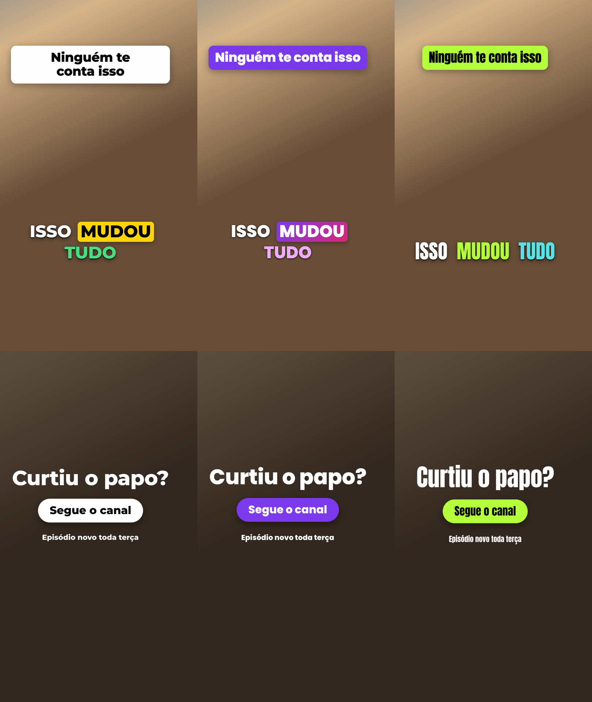

# cortes-virais

Uma skill do [Claude Code](https://claude.com/claude-code) que transforma um vídeo longo (podcast,
entrevista, live, palestra) em cortes verticais 9:16 para YouTube Shorts, Reels e TikTok, na
identidade visual do seu canal.

> **In English.** A Claude Code skill that turns a long video into vertical 9:16 clips for Shorts,
> Reels and TikTok. Claude picks the moments by reading a word-level transcript (ElevenLabs Scribe v2)
> and what Gemini saw in the video; local scripts trim to sentence boundaries, cut pauses and filler
> words, follow the active speaker with MediaPipe face tracking, burn word-by-word captions in your own
> brand style, and render with ffmpeg. Previews go to an approval board (a claude.ai artifact or a local
> page), and only approved clips are rendered in full. The skill, its prompts and its docs are in
> Brazilian Portuguese; videos in other languages work (`--idioma en`), but filler-word removal is
> tuned for Portuguese. Requires Node 22, ffmpeg, Chrome and a Replicate API token. MIT licensed.
> Built at [Box24x7](https://www.box24x7.com/?utm_source=github&utm_medium=readme&utm_campaign=cortes-virais&utm_content=english), where it cuts the company's interviews and podcasts.

## O que ela faz

1. **Transcreve** o vídeo com o tempo de cada palavra e quem fala (`elevenlabs/scribe-v2`, no
   Replicate), com os risos e aplausos marcados.
2. **Assiste** ao vídeo com o Gemini, em partes de 20 min, e anota o que só se vê ou se ouve: reação,
   riso, energia, gesto, prova na tela.
3. **Escolhe os momentos**: o Claude lê a transcrição inteira e as anotações do Gemini e propõe de 10 a
   15 cortes, com nota por uma régua de gancho, sentido sozinho, emoção, valor e desfecho, e com o
   que funcionou no histórico do canal.
4. **Confere** cada corte: bordas ajustadas ao começo e ao fim da frase, pausa longa e vício ("hum",
   "éé") cortados, corte repetido descartado, e o texto editado para o Claude reler.
5. **Enquadra** em quem está falando: os rostos são achados no Chrome (MediaPipe), cada voz é ligada à
   boca que mexe, e o recorte 9:16 segue a conversa, divide a tela nas reações ou mostra a tela inteira
   quando não há rosto.
6. **Legenda** palavra a palavra, com o card do gancho nos primeiros 4 s, na fonte e nas cores do canal,
   dentro da zona segura das três plataformas.
7. **Finaliza** cada corte, se o canal quiser, com um cartão (logo, título, botão) ou com o vídeo de
   assinatura do canal.
8. **Mostra as prévias numa mesa de aprovação** e só gera a versão final (1080×1920, -14 LUFS) do que
   alguém aprovou, com o texto do título, da descrição e das hashtags.
9. **Aprende** com os números do YouTube Studio que você registra depois de publicar.

A skill não publica nada: quem sobe os vídeos é você.

## Quem usa

<p align="center">
  
</p>

A **[Box24x7](https://www.box24x7.com/?utm_source=github&utm_medium=readme&utm_campaign=cortes-virais&utm_content=vitrine)**, onde a skill nasceu, corta com ela as entrevistas e os podcasts de que
participa. Acima, um corte da entrevista no Smart Money, feito pela versão interna que deu origem a esta: o card do gancho, a legenda palavra a palavra na
identidade da Box, a tela dividida quando os dois falam e, no fim, a tela final da marca. Essa tela foi
feita sob medida para a Box; com o modo `video` da finalização, qualquer canal põe a própria assinatura no
mesmo lugar.

Usa a skill no seu canal? Abra uma issue com o link de um corte, que ele entra aqui.

## Requisitos

- **Claude Code** (terminal, app ou IDE), no Mac, no Windows ou no Linux. No chat do claude.ai e no
  Cowork ela não roda: precisa de ffmpeg e Chrome na máquina.
- **Node 22** ou mais novo, **ffmpeg**, **Google Chrome** (ou Edge, no Windows; Chromium, no Linux) e,
  para baixar do YouTube, **yt-dlp**.
- Uma conta no **[Replicate](https://replicate.com)** com crédito e um token de API.
- Opcional: uma chave da **[Gemini API](https://aistudio.google.com/apikey)** com faturamento ativo,
  para o Gemini assistir pela API do Google em vez do Replicate.

Você não precisa instalar nada disso antes: no primeiro uso a skill confere o que falta e conduz a
instalação com você (veja [o setup](skills/cortes-virais/references/setup.md)).

## Instalação

Como plugin, no Claude Code:

```
/plugin marketplace add fabioginzel-box/cortes-virais
/plugin install cortes-virais@cortes-virais
```

Para atualizar depois: `/plugin marketplace update cortes-virais`.

Ou copiando a pasta da skill para as suas skills pessoais:

```bash
git clone https://github.com/fabioginzel-box/cortes-virais.git
cp -R cortes-virais/skills/cortes-virais ~/.claude/skills/
```

## Primeiro uso

Abra o Claude Code e peça: *"faz cortes desse vídeo: <arquivo ou link do YouTube>"*.

1. **O setup.** A skill roda `node scripts/cortes.js ambiente` e diz o que falta. Os programas ela
   oferece instalar por você (Homebrew, winget ou apt), com o seu OK. O token do Replicate você cria em
   replicate.com/account/api-tokens e guarda **no seu terminal**, com o comando que ela mostrar (no Mac,
   no Keychain; no Windows, na variável do seu usuário; no Linux, no chaveiro do sistema). Não cole o
   token na conversa. O passo a passo está em
   [references/setup.md](skills/cortes-virais/references/setup.md).
2. **A identidade visual.** Sem nenhum canal configurado, a skill pergunta se você quer configurar
   agora, numa entrevista curta (fonte, cores, palavra ativa, card, finalização, logo), ou começar
   com o estilo neutro e ajustar depois. No fim ela mostra uma amostra para você aprovar.
3. **O corte.** Daí em diante é o fluxo de sempre: transcrição, Gemini, candidatos, conferência,
   prévias, mesa de aprovação e versão final.

## A identidade visual

Cada canal tem uma pasta em `~/Documents/Cortes-Virais/canais/<canal>/` com um `marca.json`. Ele guarda
um dos três estilos prontos e só o que você trocou:

| Estilo | Fonte | Palavra que está sendo dita | Card do gancho |
|---|---|---|---|
| `classico` (o padrão) | Montserrat ExtraBold, branca com contorno preto | fundo amarelo, texto preto | branco, texto preto |
| `marca` | Poppins ExtraBold, branca com sombra | fundo na cor da marca, ou degradê | na cor da marca |
| `impacto` | Anton, maior, contorno preto | troca para verde-limão | verde-limão |



Dá para trocar a fonte (as três embutidas, um arquivo seu ou um nome do Google Fonts), as cores, o
estilo da palavra ativa (fundo, só cor ou nenhum), a caixa alta, o tamanho (P, M, G) e o card. A
posição pela zona segura e a quebra em blocos de até 3 palavras são fixas.

```json
{
  "versao": 1,
  "nome": "Meu Podcast",
  "estilo": "marca",
  "legenda": { "ativa": { "estilo": "fundo", "fundo": ["#0EA5E9", "#6366F1"], "texto": "#FFFFFF" } },
  "card": { "fundo": "#0EA5E9" },
  "finalizacao": { "modo": "cartao", "cartao": { "titulo": "Curtiu o papo?", "botao": "Segue o canal", "logo": "logo.png" } }
}
```

A **finalização** de cada corte tem três modos: `nenhuma` (o padrão); `cartao`, com a cena do fim do
corte desfocada ao fundo, o seu logo, um título, um botão e um áudio opcional; e `video`, o vídeo de
assinatura que o canal já tem. Os dois entram com uma fusão de 0,25 s.

Com vários canais (um editor que corta para clientes diferentes, por exemplo), cada um tem a sua
identidade, a sua régua e o seu histórico. Todos os campos estão em
[references/marca.md](skills/cortes-virais/references/marca.md). Para mudar depois, peça *"muda
minha identidade"*.

## A mesa de aprovação

- **Com a ferramenta de artefatos do Claude Code**, a mesa é um artefato privado no claude.ai, com as
  prévias, a nota e os avisos de cada corte, e campos para mudar título, gancho, descrição e hashtags.
  Você pode compartilhar com quem aprova.
- **Sem ela**, `mesa --local` abre a mesma mesa no seu navegador, servida só em `127.0.0.1`, e grava as
  aprovações na pasta do vídeo.
- Sem mesa nenhuma, a aprovação pode ser pela conversa.

## Custos

A skill roda na sua máquina, mas a transcrição, o Gemini e o realce são cobrados por uso na sua conta do
Replicate (e, com a `GEMINI_API_KEY`, na sua conta do Google). O custo cresce com a duração do vídeo.
Cada pasta de vídeo registra cada chamada em `replicate.jsonl` e `gemini-api.jsonl`, para você saber o
que um vídeo custou. Os preços estão na página de cada modelo:
[elevenlabs/scribe-v2](https://replicate.com/elevenlabs/scribe-v2),
[google/gemini-3.1-pro](https://replicate.com/google/gemini-3.1-pro) e
[topazlabs/video-upscale](https://replicate.com/topazlabs/video-upscale). O realce é o mais caro (uns
US$ 0,08 por segundo de vídeo em novembro de 2026) e só roda quando você pede.

## Seus dados

- O áudio do vídeo vai ao Replicate (transcrição) e uma cópia leve do vídeo, em 360p a 2 quadros por
  segundo, vai ao Gemini (pelo Replicate ou pelo Google). O enquadramento, a legenda e o vídeo final
  são feitos na sua máquina.
- Os tokens ficam no chaveiro do sistema ou numa variável sua, e a skill nunca os escreve em arquivo
  nem na conversa.
- Corte vídeo seu ou de quem autorizou.

## Limitações

- Esta é uma versão **0.x**: o fluxo inteiro foi testado com vídeo sintético e o Replicate de fora; o
  primeiro vídeo real numa máquina nova pode revelar arestas. Abra uma issue.
- A lista de vícios cortados é de português. Em outro idioma, use `--limpeza natural` ou `sem` se a
  limpeza errar.
- No Linux, os testes automáticos rodam a cada mudança, mas um vídeo de ponta a ponta ainda não foi
  feito lá.
- O Gemini do Replicate já recusou toda mídia com o erro E001. Quando isso acontece, a skill segue só
  com a transcrição; a Gemini API é a alternativa.
- O enquadramento acha rosto de frente, de lado e a meia distância; rosto muito pequeno ou de costas
  cai no layout de tela inteira.

## Desenvolvimento

```
skills/cortes-virais/
  SKILL.md            o roteiro que o Claude segue
  references/         setup, identidade visual, escolha, formato dos arquivos, estilo e créditos
  scripts/cortes.js   a entrada única dos comandos
  scripts/lib/        os módulos, cada um com o seu .test.js
  template/           as páginas que o Chrome desenha: legenda, rostos, cartão e mesa
  assets/fontes/      as três fontes embutidas, com as licenças
docs/adr/             as decisões e o porquê de cada uma
CONTEXT.md            o glossário
```

Os testes não chamam serviço pago nem precisam de token:

```bash
cd skills/cortes-virais/scripts && node --test lib/*.test.js
```

Alguns abrem o Chrome sem janela (a legenda, a mesa) ou rodam o ffmpeg de verdade (o overlay da
legenda); sem eles na máquina, esses pulam.

O GitHub Actions roda os mesmos testes no Mac, no Windows e no Linux a cada push.

## Sobre

A cortes-virais foi feita na **[Box24x7](https://www.box24x7.com/?utm_source=github&utm_medium=readme&utm_campaign=cortes-virais&utm_content=sobre)**, que aluga produtos de uso eventual, da furadeira
ao videogame, com entrega em até 1 hora. É com ela que a Box corta as próprias entrevistas e podcasts, e
o que funcionou lá virou as regras desta skill.

## Créditos e licença

As regras de escolha e de edição vieram da leitura de oito skills públicas de cortes, todas MIT; o que
veio de cada uma está em [references/boas-praticas.md](skills/cortes-virais/references/boas-praticas.md).

O código é [MIT](LICENSE). As fontes embutidas (Montserrat, Poppins e Anton) são da
[SIL Open Font License 1.1](skills/cortes-virais/assets/fontes/). O MediaPipe (Apache 2.0) é baixado
na primeira detecção de rosto, numa versão fixa, e não vem no repositório.
